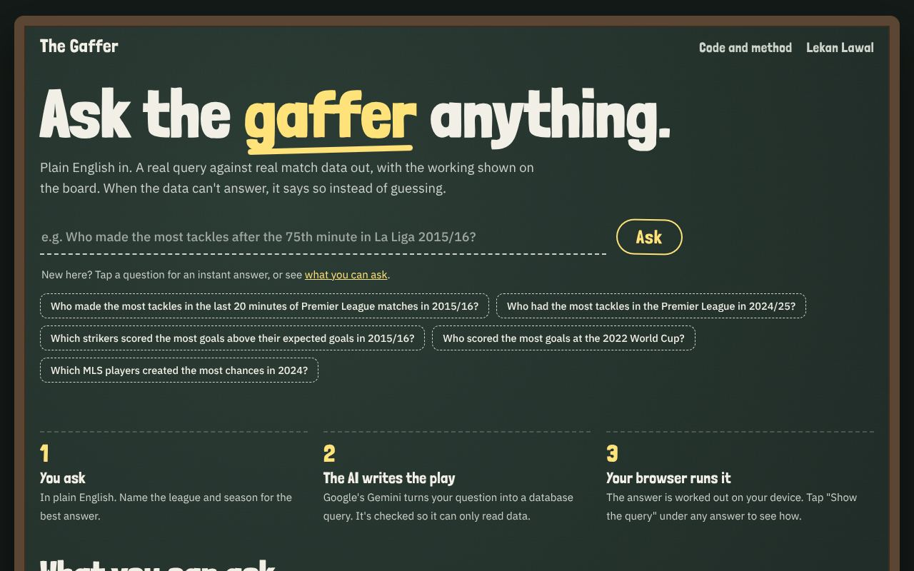

# The Gaffer

Ask a football question in plain English and get an answer worked out with real SQL, with the query shown. When the data can't answer it, it says so instead of guessing.

[Ask it something](https://lekanlawal1.github.io/football-agent/)



## Why I built it

Chatbots answer football questions confidently and get the numbers wrong. I wanted one where every answer comes from data you can check, and where "I can't answer that" is a normal response. It works for questions like "Who made the most tackles from the 70th minute on in the 2015/16 Premier League?"

## How it works

Your question goes to Gemini through a small Cloudflare Worker that keeps the API key private. Gemini can do one of three things: write a SQL query, ask you to clarify, or say the data can't answer it. The page checks the SQL is a single read-only query that works against the real tables, then runs it in your browser with DuckDB. There's no database server to keep running or attack.

The data is StatsBomb's free event data: 1,853 matches, including four full 2015/16 European leagues and recent World Cups and Euros, with every shot, tackle and card down to the minute. Newer 2024/25 season data is filling in daily from API-Football's free plan.

I also built my own expected-goals (xG) model, which estimates how likely each shot was to go in. It gets close to StatsBomb's professional model, on the same shots.

## What I found

I test it on 51 questions: 25 with answers I worked out by hand, 6 that need a clarifying question, 8 the data can't answer, and 12 attacks like prompt injection and attempts to change data. On the latest run it got all 22 answerable ones right (3 are waiting on newer data), and passed every other test.

That took a few rounds. The first runs caught wrong answers that looked right. Asked which team scored most in Serie A, it said Napoli with 49, because it counted home and away goals separately and never added them. I fixed that by changing how the data is laid out rather than special-casing the question. Roma's 83 is now the answer.

The data has its own checks too. Goals from shots plus own goals must equal the final score in every one of the 1,853 matches. That caught a real mismatch, where "Olympique de Marseille" and "Marseille" were treated as two different teams.

## Run it

```bash
pip install -r requirements.txt
python -m src.statsbomb_ingest   # about 10 minutes the first time
python -m src.xg                 # train and test the xG model
python -m src.build              # build the database and run the data checks
python -m pytest -q
python -m src.evaluate           # needs GEMINI_API_KEY
```

## More

[docs/details.md](docs/details.md) has the full write-up, including the xG results table and every data source. The latest evaluation is in [docs/eval_results.md](docs/eval_results.md).

Event data: [StatsBomb open data](https://github.com/statsbomb/open-data), free for public use with attribution.
